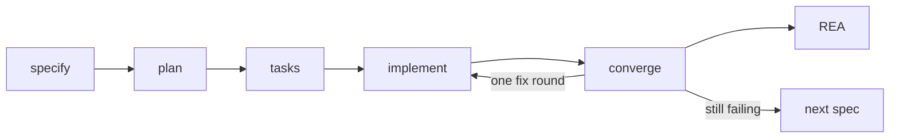

# Phase card



## Obligations per phase

Run each row as the pstack skill when it is installed.
On Claude that is `/pstack:<skill>`.
On Cursor and Codex, use the bare skill name.
If the skill is missing, carry out the obligation in your own words.
Record one breadcrumb per row.

| Phase | Obligation | Skill | Must leave |
|-------|------------|-------|------------|
| Enter / resume | `O-sharpen` | `sharpen` (`recall` when cold) | Final Goal + AC pinned in `progress.md`; plan the whole Final Goal as **one** spec, even when it names several commands; split only at `tasks`, past ~12 tasks |
| Enter, existing code touched | `O-how` | `how` | file:line evidence in `plan.md` |
| `specify` / `clarify` | `O-specify` | `technical-writing` + `unslop` | spec prose; assumptions marked |
| `plan`, code crosses a function boundary | `O-architect` | `architect` | plan + verification contract |
| `tasks` | `O-sequence` | `principle-sequence-verifiable-units` | ordered `tasks.md`; each task ends in a check; the gate refuses more than 12 tasks |
| `implement` | `O-poteto` | poteto-mode non-negotiables | admitted task IDs; inline unless a trigger holds; `git worktree remove` after the leaf's diff is merged |
| Pre-converge | `O-blast`, `O-hygiene` | `blast-radius`, `no-comments` | external risk proved or task-tracked; no narrating comments |
| `converge` | `O-interrogate` | `interrogate` | one verifier, in the foreground; no `ScheduleWakeup`; gaps appended to `tasks.md` |
| Post-converge | `O-rea` | REA (below) | Evidence ID bound to the current code |
| Before `/compact` or host switch | `O-pause` | `pause-safely` | `progress.md` current |

`converge` runs once per spec.
`progress_gate.py` refuses a second `Convergence` header and a leftover git worktree.
Gap tasks get one `implement` round, then REA.
If they still fail, mark `closed-carryover` and specify the gap next.

## Breadcrumbs

One line per obligation, at column 1, in `progress.md`. Bullets are not
counted.

```text
harness: L1 ok|L2 ok|…            (from scripts/harness_probe.py)
pstack: O-poteto|<host>|inline → T001–T004 verified
pstack: O-interrogate|<host>|<reviewer subagent_type> → <n> findings
rea: <feature>|pass|<ev_… id copied verbatim>
ROUTING: <role> → <model>@<level> (source: sheet|default|parent) observed: …|unknown
```

No reviewer can run → `pstack: O-interrogate|<host>|BLOCKED: independent review`,
and the Final Goal stays open.

Before "Final Goal met", this command must print `ok`:

`python3 <this skill>/scripts/progress_gate.py progress.md`

That script is the only completion predicate.
It names a bulleted or backticked breadcrumb, a secret-shaped token, and a feature directory with no closing line.
Write `<REDACTED>` instead of a secret.
Close with `rea: <feature>|pass|ev_…`, or `rea: <feature>|not-applicable|<why>` when nothing runnable exists.
Omit an older directory only with `gate: exclude|<feature>|<why>`.

## REA closeout, common path

1. Use the REA MCP tools when connected, else the `rea` CLI.
   If both are missing on delivery or repair, install the pin, then register the active host only:

   `npm install -g rea-agents@6.7.0`

   `rea setup --yes --client <claude_code|codex|cursor|grok_build>`
2. Pick the smallest capture for the artifact:
   - CLI or script → `capture_process_scenario` on the real command (P1 path
     and one failure path).
   - Node/Electron bundle → `analyze_javascript_application`.
   - Web app → `capture_browser_scenario` with a real P1 action and `at_end`
     `url` + `dom` or `accessibility`; a URL-only capture is not a pass.
3. Copy the Evidence ID verbatim into `progress.md` (`rea:` line) and
   `converge.md` if the feature has one.
4. Disposition, which `scripts/progress_gate.py` enforces:

   | Disposition | Closes? | When |
   |-------------|---------|------|
   | `pass` | yes | Evidence ID present, no material finding |
   | `not-applicable` | yes | No runnable artifact, reason recorded |
   | `tasks-appended` | no | Material finding; one fix round, then REA again |
   | `blocked-limitation` | no | Tooling failed after an alternate path |

## Open the long references only when

| Need | Read |
|------|------|
| Spawning a leaf or the one verifier on a given host; review gate details; port-only skills | [pstack-integration.md](pstack-integration.md) |
| REA install fails, web/SPA capture details, known REA failures | [rea-closeout.md](rea-closeout.md) |
| A harness layer reports a gap | [harness-layers.md](harness-layers.md) |
| Whether to spawn at all | [single-loop-default.md](single-loop-default.md) |
| A phase's evidence class, who may write the artifact, or the handoff block is unclear | [phase-contract.md](phase-contract.md) |

## Spawn brief

An output style applies to the parent conversation and its forks.
It does not apply to an ordinary subagent.
This card does not apply there either.
Paste the matching block into the spawn prompt.
A file path is not a substitute.

### Leaf

- Admitted task IDs, the paths this packet may edit, and the acceptance check.
- Read `poteto-mode/SKILL.md` at the absolute path the parent gives you.
- Do not spawn another subagent.
- Do not push, merge, or deploy.
- Return one line: `changed paths | commands run → decisive output line | acceptance IDs → met/unmet/blocked | open risks`.

### Verifier

- You did not write this diff. Read the spec and the diff.
- Do not edit source. Do not mark the Final Goal met.
- Return findings as act-on, consider, noted, or dismissed.
